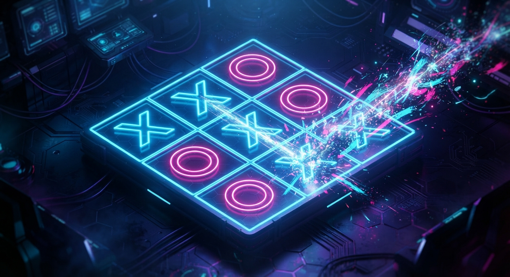
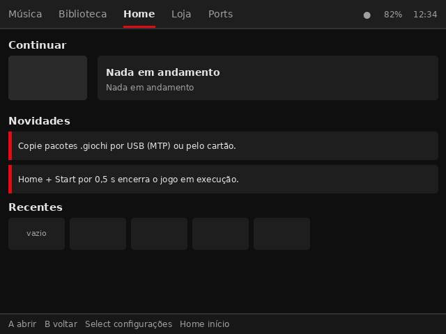
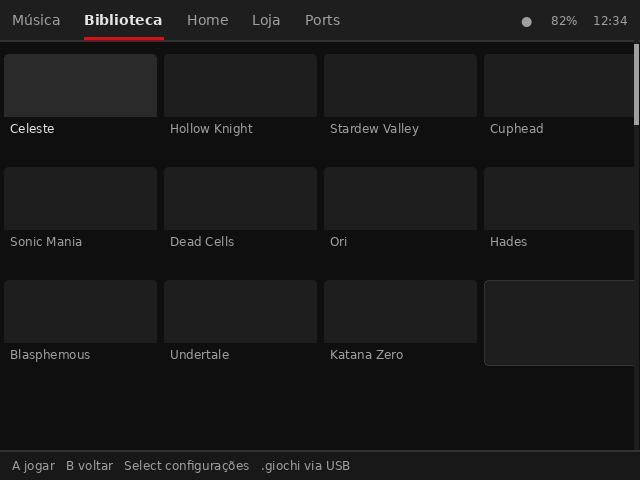
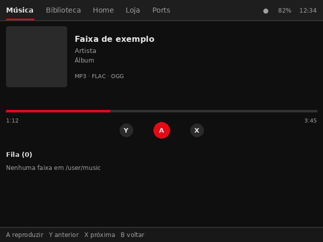
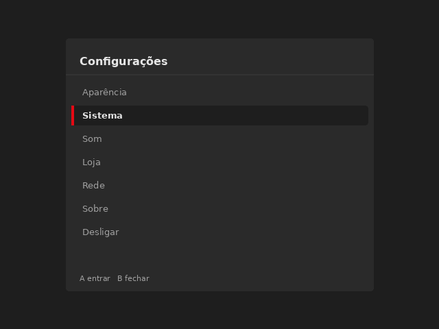
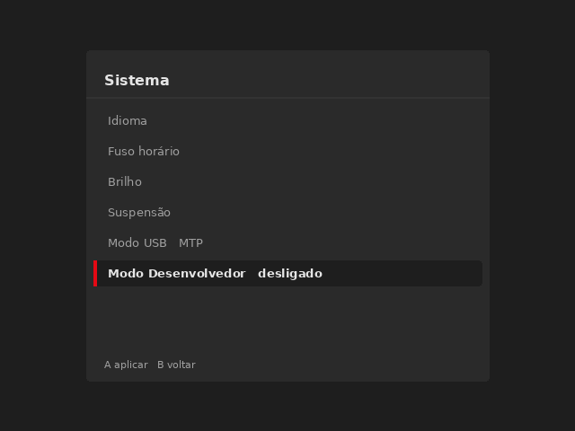
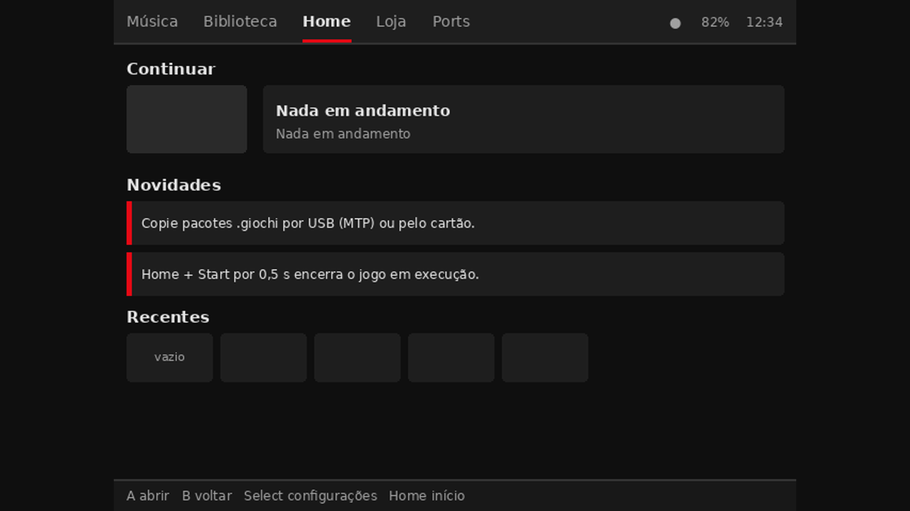
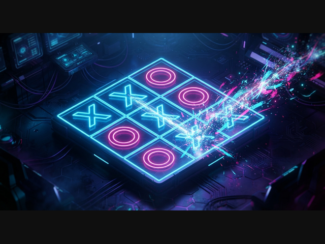

# Giochi Konsol OS

[](https://github.com/xtrempkch-droid/GIOCHI-KONSOL-OS/actions/workflows/ci.yml)
[](https://github.com/xtrempkch-droid/GIOCHI-KONSOL-OS/actions/workflows/images.yml)
[](LICENSE)


Sistema operacional enxuto para portáteis ARM, feito para **ligar rápido, gastar
pouca RAM e jogar em OpenGL ES** — sem systemd, sem PulseAudio, sem desktop.

Alvo: **1–2 GB de RAM**, tela sem toque, entrada por botões (gamepad evdev),
armazenamento em microSD (slot único ou duplo). Rede e Bluetooth são
**opcionais**: integrados quando o aparelho tem rádio, ou via dongle USB.

> **Estado:** v1.2. O núcleo (supervisor, launcher, daemon de música,
> empacotamento/assinatura, update A/B, USB com MTP e SSH) está implementado e
> testado. A renderização dos widgets e a decodificação de áudio ainda são
> esqueletos — a tabela [Estado da implementação](#estado-da-implementação) diz
> exatamente o que roda hoje.

---

## Como é na tela

As imagens abaixo são **geradas por script** a partir dos assets reais do
sistema (`theme.json`, `layout.json`, `home.json`, `library.json`,
`music.json`) — a mesma geometria e a mesma paleta que o Launcher usa. **Não
são capturas de tela de hardware**: o desenho dos widgets no backend SDL2 ainda
é esboço. Leia [docs/SCREENSHOTS.md](docs/SCREENSHOTS.md) antes de usar em
material de divulgação.

| Home | Biblioteca |
|---|---|
|  |  |

| Música | Configurações |
|---|---|
|  |  |

| Configurações → Sistema (Modo Desenvolvedor) | Powkiddy X55 (1280×720) |
|---|---|
|  |  |

E o splash de boot — este é **real**: o arquivo em
`assets/bootlogo/bootlogo.rgba` é desenhado pelo Launcher nos primeiros frames.



Regenerar: `make screenshots` (precisa de `pillow`).

---

## Estado da implementação

| Área | Situação | Onde |
|---|---|---|
| Buildroot (`BR2_EXTERNAL`), 5 aparelhos, genimage A/B | ✅ funcional | [buildroot/](buildroot/) |
| Kernel 6.12 + fragmentos (gadget, dongles, Powkiddy) | ✅ funcional | [board/giochi](buildroot/board/giochi) |
| U-Boot mainline + BL31/DDR do rkbin (X55) | ✅ configurado, imagem bootável | [devices/x55.conf](buildroot/board/giochi/devices/x55.conf) |
| `giochi-init`: supervisor, `control.sock`, FIFO, hotkey, `device_profile.json` | ✅ funcional | [src/init](src/init) |
| Ciclo de vida Launcher/jogo/app (§2.2/§4.7) | ✅ funcional, testado | [tests/integration](tests/integration/lifecycle_test.sh) |
| Launcher C++17: layout 1.6, 5 abas, `buttons.map`, biblioteca, overlay 2 níveis | 🟡 motor pronto, widgets pendentes | [src/launcher](src/launcher) |
| `giochi-musicd`: socket/protocolo §4.8.4 | 🟡 protocolo pronto, decode ALSA pendente | [src/musicd](src/musicd) |
| `.giochi`: pack, extract (ustar embutido), thumbgen | ✅ pack/extract, 🟡 thumbnails | [tools/](tools/) |
| Update A/B com Ed25519 + SHA-256 | ✅ funcional (verificado ponta a ponta) | [tools/giochi-verify.c](tools/giochi-verify.c) |
| `giochi-forge`: detecção, classificação, assinatura | ✅ funcional | [src/forge](src/forge) |
| USB: MTP + rede/SSH + Mass Storage (gadget composto) | ✅ funcional | [scripts/giochi-usb-mode](scripts/giochi-usb-mode), [docs/USB.md](docs/USB.md) |
| Modo Desenvolvedor (SSH via USB, §4.6.1) | ✅ funcional, testado | [tests/integration/devmode_test.sh](tests/integration/devmode_test.sh) |
| Dongles USB Wi-Fi/BT | ✅ hotplug e scripts, 🟡 UI de rede | [scripts/init.d/S40dongle](scripts/init.d/S40dongle) |

---

## Aparelhos

| Aparelho | SoC | Painel | Rádio | Bootloader | Status |
|---|---|---|---|---|---|
| Powkiddy X55 | RK3566 | 720×1280 (rot. 270°) | RTL8821CS integrado | U-Boot mainline + rkbin | **validado em hardware** |
| Powkiddy X35S | RK3566 | 640×480 | não medido | vendor (sem defconfig mainline) | não validado (DTS externo) |
| Powkiddy X35H | RK3566 | 640×480 | nenhum | vendor | parcial |
| RK3566 genérico | RK3566 | 640×480 | dongle USB | `quartz64-a-rk3566` | bring-up |
| RK3326 genérico | RK3326 | 640×480 | dongle USB | vendor (idbloader) | bring-up |

Detalhes de DTS, DTB externo, fallback de teste e como adicionar uma placa:
[docs/DEVICES.md](docs/DEVICES.md).

---

## Começando

### Build + testes no host

Só precisa de `gcc`/`g++` (C99/C++17) e `python3`. As bibliotecas opcionais
(SDL2, ALSA, libpng, libarchive, OpenSSL) são detectadas por `pkg-config`; sem
elas o código usa os stubs previstos na especificação.

```sh
make            # build/host/bin/{giochi-init,giochi-musicd,giochi-launcher,...}
make test       # unitários, integração (ciclo de vida, USB, Modo
                # Desenvolvedor), bootlogo e forge
make lint       # shell, JSON, defconfigs, links, arquivos versionados e
                # símbolos do Buildroot/U-Boot (quando as árvores existem)
make info       # mostra o que o pkg-config detectou
```

### Imagem para o cartão

```sh
export BUILDROOT_DIR=/caminho/para/buildroot   # LTS 2024.02.x

tools/build-image.sh --check --all      # valida tudo sem compilar
tools/build-image.sh x55                # dist/x55/giochi-x55-sdcard.img
tools/build-image.sh --all --jobs 8     # todos os aparelhos
```

Grave com `dd if=dist/x55/giochi-x55-sdcard.img of=/dev/sdX bs=4M conv=fsync`
ou Balena Etcher. O cartão sai com A/B (SquashFS), partição `/user` (ext4) e
`extlinux.conf` apontando para o DTB do aparelho.

Para a **X55** o U-Boot mainline (`powkiddy-x55-rk3566`, desde a v2024.07) é
compilado junto, com BL31 e DDR vindos do `rkbin` — a imagem é bootável de
fábrica. Nos demais aparelhos não existe defconfig mainline: a imagem sai **sem
bootloader** e você precisa gravar o do vendor antes. Ver
[docs/DEVICES.md](docs/DEVICES.md#bootloader).

### Inspecionar o aparelho por USB

O console expõe rede no mesmo gadget do MTP. O **Modo Desenvolvedor** (SSH via
USB) vem **desativado**; ligue em Configurações → Sistema → Modo Desenvolvedor.

```sh
sudo ip addr add 10.55.0.1/24 dev usb0    # PC: estático, não há DHCP
ssh root@10.55.0.2                        # console
```

Autenticação por chave pública em `/user/ssh/authorized_keys` ou por senha de
root definida no build (`GIOCHI_ROOT_PASSWORD`). Detalhes em
[docs/USB.md](docs/USB.md).

---

## Como funciona

```
BootROM → U-Boot (A/B + bootcount) → kernel 6.12 → BusyBox init (/etc/inittab)
        → giochi-init (supervisor) → Gamescope (DRM/KMS) → giochi-launcher
                                        ↘ jogo / app externo
                                        ↘ giochi-musicd (persistente)
                                        ↘ umtprd (MTP) + usb0 (SSH)
```

- **Supervisor** (`giochi-init`): dono do Launcher, jogos, apps e daemons.
  Um único `poll()` sobre self-pipe de sinais, `/run/giochi/control.sock`, a
  FIFO `/run/giochi/transition` e os `event*` do hotkey.
- **Transições:** jogo → `SIGTERM`+`waitpid` no Launcher, exec, e o Launcher é
  reiniciado ao sair; app externo (Ports/Loja) → Launcher suspenso (`SIGSTOP`),
  retomado (`SIGCONT`) ao voltar.
- **UI:** 5 abas (Música · Biblioteca · Home · Loja · Ports), grid estilo
  YouTube, tema escuro `#0F0F0F`/`#E50914`. `layout.json` schema 1.6 com
  fallback compilado.
- **Pacotes:** `.giochi` é tar puro (ADR-11). O Launcher valida `arch`,
  `entrypoint` e `runtime` antes de listar.
- **Update:** A/B atômico, assinatura Ed25519 + SHA-256, rollback por
  `bootcount`. Update remoto depende de Wi-Fi (dongle ou integrado).
- **Memória:** zRAM 512 MB/1 GB com `-p 100`; swap em SD `-p 10` apenas no
  modo A do slot 2, com benchmark random 4K.

---

## Estrutura

```
src/common/     JSON, log, sockets, SHA-256, Ed25519, hotkey, FIFO
src/init/       giochi-init: supervisor, control.sock, power, device_profile, game
src/launcher/   motor de layout, tema, settings, overlay, evdev, render SDL2
src/musicd/     giochi-musicd (ALSA + música)
src/thumbgen/   thumbnails 152x85 RGBA
src/forge/      giochi-forge (PC): perfil, classificação, empacotamento
assets/         layout, tema, defaults, buttons.map, devices/<id>/, bootlogo/
schemas/        JSON Schema (metadata, forge, settings, layout)
scripts/        init.d/* e helpers (USB gadget)
buildroot/      BR2_EXTERNAL: defconfigs, board, packages
tools/          build-image, gen-defconfigs, bootlogo, screenshots, pack, sign, verify, QA
tests/          unitários (C/C++), forge (Python) e integração
docs/           arquitetura, hardware, build, aparelhos, USB, QA, handoff
```

---

## Documentação

| Documento | Conteúdo |
|---|---|
| [docs/architecture-v1.2.md](docs/architecture-v1.2.md) | especificação consolidada (fonte normativa) |
| [docs/architecture-v1.1.md](docs/architecture-v1.1.md) | versão anterior, para histórico |
| [docs/hardware-e-drivers.md](docs/hardware-e-drivers.md) | hardware de teste, GPIO, DTS, correções (F1–F12) |
| [docs/DEVICES.md](docs/DEVICES.md) | aparelhos, DTS, bootloader, geração de imagem |
| [docs/USB.md](docs/USB.md) | MTP, Mass Storage e **SSH via USB** (10.55.0.2, Modo Desenvolvedor) |
| [docs/SCREENSHOTS.md](docs/SCREENSHOTS.md) | imagens do sistema: como são geradas e o que representam |
| [docs/BOOTSPLASH.md](docs/BOOTSPLASH.md) | logo/bootsplash: assets, Launcher e ativação do U-Boot |
| [docs/BUILD.md](docs/BUILD.md) | buildroot, kernel, cross-compile, assinatura |
| [docs/QA-CHECKLIST.md](docs/QA-CHECKLIST.md) | checklist por camada e matriz de testes |
| [docs/HANDOFF.md](docs/HANDOFF.md) | estado por sessão, decisões e pendências |
| [Prompt.md](Prompt.md) | orquestração S0–S15 usada para implementar |

---

## Bootsplash

O logo em [docs/logo.jpg](docs/logo.jpg) vira o splash do sistema:
`make bootlogo` gera `assets/bootlogo/bootlogo.rgba` (desenhado pelo Launcher
nos primeiros frames) e `assets/bootlogo/<aparelho>/splash.bmp` (pré-pronto para
o U-Boot, com o bloco comentado esperando a inicialização de vídeo do SoC).
Suporte, controles e como ativar: [docs/BOOTSPLASH.md](docs/BOOTSPLASH.md).

---

## Segurança

- Imagens de update exigem **Ed25519 + SHA-256**; binário sem suporte a
  assinatura **recusa** o update (nunca aceita imagem não verificada).
- O **Modo Desenvolvedor** (SSH) vem desligado e escuta só em `usb0`
  (`10.55.0.2:22`), com senha **ou** chave; sem nenhuma das duas o daemon não sobe.
- Credenciais Wi-Fi ficam em `/user/settings.json` em texto plano na v1.2 —
  risco documentado; keyring está na fase 2.
- Chaves privadas nunca entram no repositório (`.gitignore`); só a pública vai
  para `/etc/giochi/pubkey.ed25519`.

---

## Referências e créditos

Este projeto é um sistema próprio, mas se apoia em trabalho de terceiros para o
que é hardware-specific:

- **[xtrempkch-droid/Walkmam_RK3566](https://github.com/xtrempkch-droid/Walkmam_RK3566)**
  — bring-up dos mesmos aparelhos (X55/X35S/X35H) com Debian/Kodi/RetroArch.
  Foi a referência que confirmou o defconfig **`powkiddy-x55-rk3566`** do U-Boot
  mainline, os blobs de BL31/DDR do `rkbin` (`rk3568_bl31_v1.43.elf`,
  `rk3566_ddr_1056MHz_v1.18.bin`) e o offset de gravação do bootloader
  (32 KiB para `idbloader`, 8 MiB para `u-boot.itb`).
- **ROCKNIX / JELOS** — referência de DTS, `rocknix-joypad` e política de
  rotação de painel nos Powkiddy.
- **Buildroot** (LTS 2024.02.x) — base do cross-compile, do rootfs e do
  `genimage`.
- **U-Boot**, **ARM Trusted Firmware**, **rkbin** (Rockchip), **Linux mainline**,
  **Mesa/Panfrost**, **SDL2**, **BusyBox**, **Dropbear**, **uMTP-Responder**,
  **ALSA**, **mpg123/FLAC/Vorbis** — cada um sob a sua licença. Device trees e
  patches que não são upstream pertencem aos seus autores; ver
  [buildroot/board/giochi/dts/README](buildroot/board/giochi/dts/README).

### Sobre o uso de IA

O código deste repositório foi escrito com assistência de IA (GitHub Copilot) e
revisado por execução: build, testes de host, testes de integração e validação
contra as árvores reais de Buildroot/U-Boot. O que **não** foi verificado em
hardware está marcado como tal — por exemplo, X35S e X35H nunca foram testados
em aparelho real. Desconfie do que não tem evidência neste documento: as
decisões e as correções ficam registradas em
[docs/HANDOFF.md](docs/HANDOFF.md) justamente para não voltarem.

---

## Contribuindo

Leia [CONTRIBUTING.md](CONTRIBUTING.md). Antes de abrir PR: `make lint`,
`make test` e `tools/build-image.sh --check --all`.

## Licença

[MIT](LICENSE), exceto componentes de terceiros citados acima, que mantêm suas
licenças originais.
