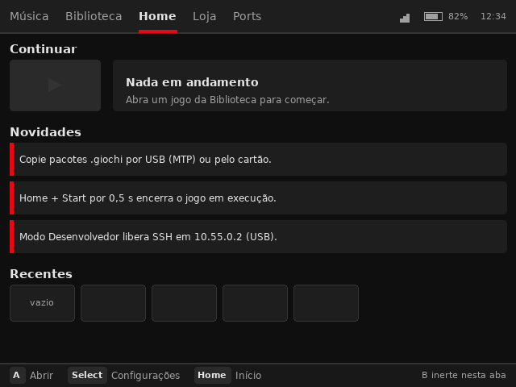
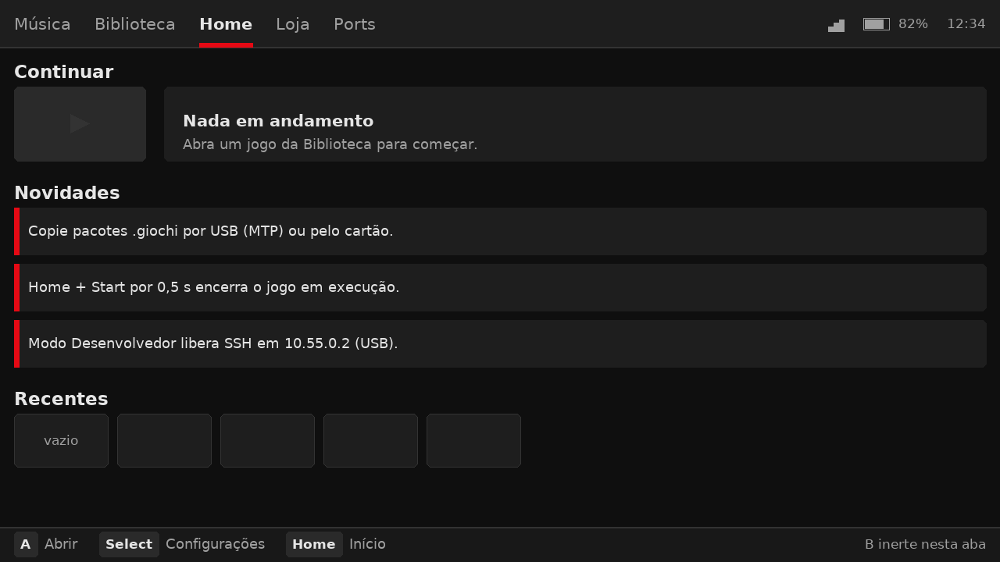
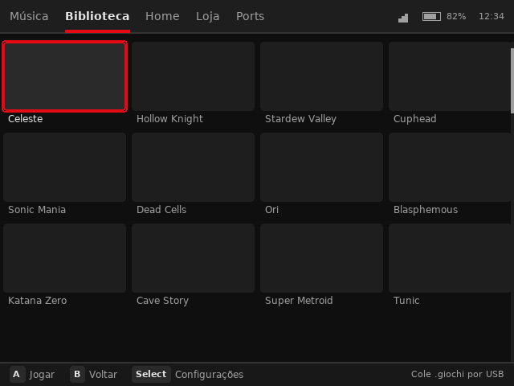
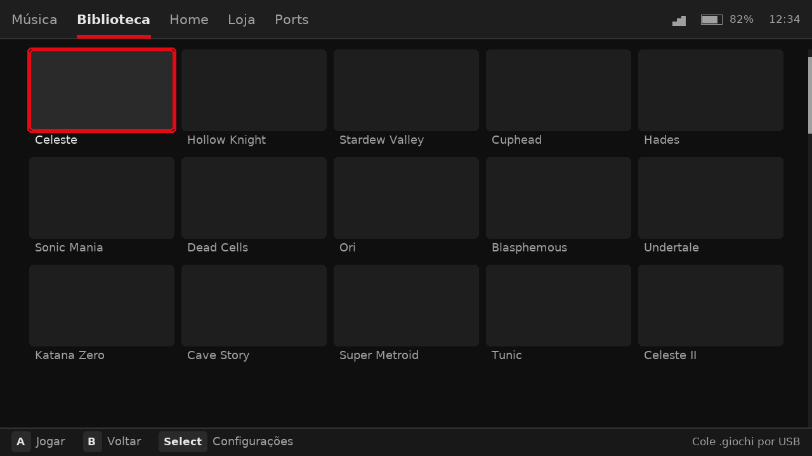
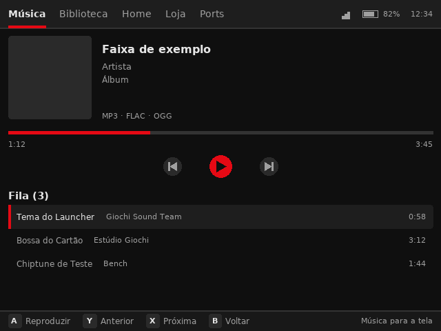
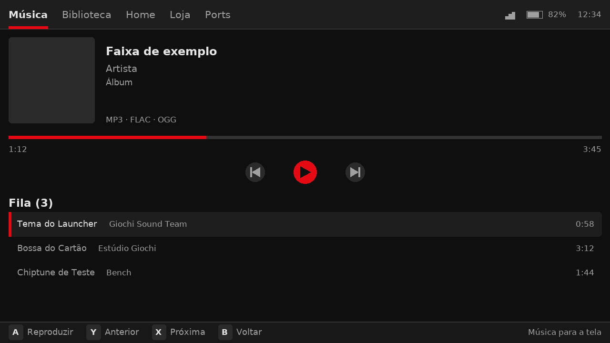
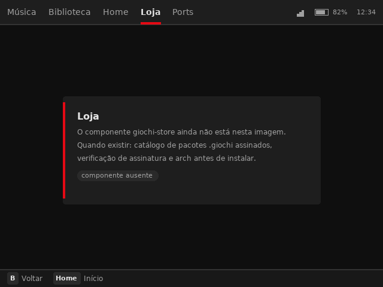
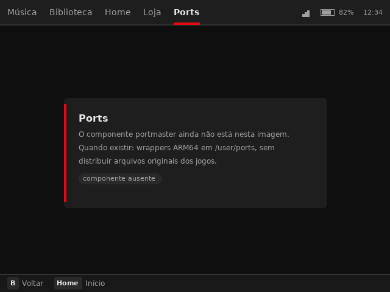

# Proposta de layout — as 5 abas em 640×480 e 1280×720

**Status:** a decisão de layout foi aprovada em 2026-10-30 (perfil ×1,5 e 5
colunas) e **aplicada nos assets do aparelho** — `assets/devices/x55/*.json`
agora carrega o perfil, e `tests/test_device_scale.py` impede que ele volte a
divergir. O desenho no `render.cpp` continua pendente (depende de D5, o
pipeline de texto). A especificação `docs/architecture-v1.2.md` **não** foi
alterada.

O estado dos renders de documentação (`docs/screenshots/`) está em
[SCREENSHOTS.md](./SCREENSHOTS.md); este documento descreve o alvo.

- Especificação normativa: [architecture-v1.2.md](./architecture-v1.2.md) (§4.1).
- Armadilhas e convenções: [../AGENTS.md](../AGENTS.md).
- Renders: `docs/proposta/*.png` — gerados, nunca desenhados à mão.

---

## 1. O que a proposta é e o que não é

**É:** geometria e tipografia calculadas a partir de `assets/theme.json`
(cores, `tile_corner_radius`, `tile_title_size`) e dos tamanhos declarados em
`assets/home.json`, `assets/library.json` e `assets/music.json` — e, no painel
da X55, dos três arquivos equivalentes em `assets/devices/x55/`, que são o
layout canônico multiplicado por 1,5. O gerador **lê** esses arquivos: não
aplica escala em cima de escala.

**Não é:**

- **captura de tela** — `src/launcher/render.cpp` ainda só pinta o fundo do tema
  e o splash (o `TODO(v1.2)` na linha 219);
- **medida em aparelho** — nada desta proposta rodou em hardware;
- **cor nova** — os 10 renders usam apenas as 8 cores de `assets/theme.json`;
- **proposta de conteúdo** — os nomes de jogo e de faixa são de exemplo, como em
  `tools/make-screenshots.py`; existem para dar escala ao tile.

Uma diferença deliberada em relação a `make-screenshots.py`: os renders da
proposta são **nativos** em cada resolução. O script atual desenha 640×480 e
depois escala para 720 de altura com barras laterais
([SCREENSHOTS.md](./SCREENSHOTS.md) §"Por que a X55 aparece com barras
laterais"); é honesto sobre a proporção, mas mostra um texto borrado e não
responde à pergunta que importa — *o que cabe no painel 16:9?*

## 2. Princípios

1. **Sem toque.** Todo alvo é alcançável com D-pad, A, B, L/R, Home e Select
   (§4.1.1). Nada depende de hover, de cursor ou de precisão de toque.
2. **Um sistema, dois painéis.** As métricas do layout canônico (640×480)
   multiplicadas por 1,5 e arredondadas para inteiro. O painel de 640×480 fica
   **idêntico** ao declarado hoje; o de 1280×720 ganha o espaço que já existe.
3. **Foco sempre visível.** O item focado tem anel de acento (grade) ou
   sublinhado (aba) e o título passa a `text_primary`; o hint bar diz o que os
   botões fazem **naquela** aba, e só lista botão que funciona.
4. **Densidade honesta.** A grade ocupa 632 de 640 px no painel pequeno (4
   colunas) e 1188 de 1280 no grande (5 colunas). Nada de esticar tile.
5. **Zero cor nova.** Estado vazio, desabilitado e indisponível usam `surface`,
   `surface_elevated` e `divider`. Acento é reservado para foco e ação primária.

## 3. Perfil de painel: a tabela de tokens

| Token | 640×480 | 1280×720 | Origem / regra |
|---|---|---|---|
| `topbar` | 40 | 60 | `theme.json` `metrics.topbar_height` ×1,5 |
| `hint_bar` | 30 | 45 | `theme.json` `metrics.hint_bar_height` ×1,5 |
| fonte da aba | 14 | 21 | `layout.json` `tabs.bar.font_size` ×1,5 |
| `tile` | 152×85 | 228×128 | `library.json` `grid.tile_size` ×1,5 (85→127,5→128) |
| `titulo` (altura) | 20 | 30 | `library.json` `grid.title_height` ×1,5 |
| fonte do título | 12 | 18 | `theme.json` `typography.tile_title_size` ×1,5 |
| `gap` | 8 | 12 | base 8 ×1,5 |
| margem | 12 | 18 | base 12 ×1,5 |
| canto | 4 | 6 | `theme.json` `metrics.tile_corner_radius` ×1,5 |
| scrollbar | 4 | 6 | `library.json` `regions.scrollbar.width` ×1,5 |
| `hero` (Continuar) | 112×63 | 168×95 | `home.json` `continue.size` ×1,5 |
| recentes | 80×45 | 120×68 | `home.json` `recent.item_size` ×1,5 |
| capa (Música) | 120 | 180 | `music.json` `album_art.size` ×1,5 |
| título de seção | 15 | 23 | base 15 ×1,5 (15→22,5→23) |
| corpo | 12 | 18 | base 12 ×1,5 |
| metadado | 11 | 17 | base 11 ×1,5 (→16,5→17) |
| **colunas** | **4** | **5** | maior `n` com `n·tile + (n−1)·gap ≤ largura − 2·4px` |
| largura da grade | 632 | 1188 | medido pelo gerador |
| fim da grade | 383 | 576 | topo do conteúdo + 3 linhas |

Regras de arredondamento: `int(base × 1,5 + 0,5)` — arredonda meio para cima.
`round()` do Python usaria arredondamento bancário e transformaria 22,5 em 22,
meio pixel de diferença em toda métrica de texto do painel grande.

### 3.1 Por que 1,5 e não 2

Não existe escala inteira que sirva: 1280/640 = 2 na horizontal e 720/480 = 1,5
na vertical. Escalar por 2 na altura põe a grade de 3 linhas em 690 px contra
580 px disponíveis (número já registrado em
[roadmap.md](./roadmap.md) §3). Por isso o perfil é **vertical** — 1,5 — e a
largura extra vira **coluna**, não esticamento.

### 3.2 Por que 4 colunas no painel pequeno (e não 5)

4 × 152 + 3 × 8 = **632**, com 4 px de margem de cada lado em 640. Um quinto
tile exigiria 792 px. É aritmética declarada, não preferência: a margem de 4 px
é o que define a grade 4×3 da §4.1.4.

No painel grande, 5 × 228 + 4 × 12 = **1188**, sobrando 46 px de cada lado — a
quinta coluna cabe porque o perfil é ×1,5, não ×2.

### 3.3 O que os assets da X55 declaram — e o guarda que impede a volta

Até 2026-10-30 `assets/devices/x55/*.json` **não** seguia um fator único: cada
campo tinha sido escolhido à mão. Medido nos arquivos daquela versão:

| Campo | 640 (base) | X55 (antes) | Fator implícito |
|---|---|---|---|
| `top_bar.height` | 40 | 56 | 1,40 |
| `hint_bar.height` | 30 | 40 | 1,33 |
| `tile_size` | 152×85 | 288×162 | 1,89 |
| `title_height` | 20 | 26 | 1,30 |
| `continue.size` | 112×63 | 224×126 | 2,00 |
| `recent.item_size` | 80×45 | 160×90 | 2,00 |
| `album_art.size` | 120 | 200 | 1,67 |
| `controls.height` | 50 | 64 | 1,28 |

Sete fatores diferentes para o mesmo painel, e uma consequência concreta de
orçamento: 24 texturas de 288×162 RGBA ocupam 24 × 186 624 B = **4,48 MB**,
acima do teto de 4 MB da §4.1.6. Com o perfil ×1,5 (228×128) as mesmas 24
texturas ocupam **2,80 MB** — a quinta coluna entra sem estourar o teto.

**Os assets foram reescritos para o perfil** e o número agora é conferido por
`tests/test_device_scale.py` (suíte `escala-x55`, em `make test` **e**
`make lint`): cada inteiro de `assets/devices/x55/*.json` tem de ser
`round(base × 1,5)`, ou estar na lista explícita de política (igual ao base:
`vram_budget_kb`, `rows`, `max_items`, `max_textures_per_tab`, tempos de
`hold`…), ou ser um dos especiais do painel (`screen.*` = 1280×720 e
`columns` = 5). Campo novo que não se encaixe **falha** — é assim que o próximo
fator implícito não entra por engano.

O teste também refaz a aritmética da grade (5 × 228 + 4 × 12 = 1188 ≤ 1272) e o
orçamento de VRAM, e foi validado ao contrário: voltar `tile_size.width` para
288 faz falhar com `288 != 228 : esperado round(152 x 1,5)`.

Consequência para o gerador de renders: ele passou a **ler** os arquivos do
aparelho (`assets/devices/x55/*.json`) em vez de multiplicar o layout base. Os
10 PNGs de `docs/proposta/` saíram byte a byte idênticos depois da troca — prova
de que o valor está nos assets, não no script.

## 4. Anatomia comum

### 4.1 Topbar (40 / 60)

Cinco abas à esquerda, na ordem da §4.1.2 (Música → Biblioteca → Home → Loja →
Ports), com Home no centro visual; cada rótulo é **medido** e o próximo começa
em `x + largura + 20` (30 no painel grande). O ativo recebe `text_primary` +
sublinhado de acento de 3 px (4 no grande), alinhado ao texto, não ao padding.

À direita, na ordem de leitura: barras de rede → ícone de bateria → `82%` →
relógio, posicionados **da direita para a esquerda** e separados por 16 px. O
gerador falha se os indicadores encostarem no último rótulo de aba — a colisão
que a barra de dicas tem hoje (rótulos separados por três espaços dentro de uma
única string) deixa de ser possível por construção.

### 4.2 Hint bar (30 / 45)

Deixa de ser uma frase e passa a ser uma **lista de pares** `(botão, ação)`:
chip com o nome do botão em `surface_elevated` (raio 3, texto 11/17) e a ação em
`text_secondary`. O último item não tem gap depois dele. À direita, uma dica de
contexto que **não é botão** (ex.: `Cole .giochi por USB`), alinhada à direita.

Regras:

- **Item que não funciona não aparece.** Na Home, `B` é inerte (§4.1.2); em vez
  de um "hint cinza" a proposta **omite** o item e diz por texto que B não faz
  nada. Menos ruído e nenhum botão morto.
- **Medido:** a aba mais carregada (Música, 4 itens) usa **362 de 628 px** no
  painel pequeno e **550 de 1262 px** no grande — 58% e 44% do espaço. Sobra
  largura para a dica da direita e para uma sexta aba, se um dia existir.
- A altura do chip vem da métrica do texto, não da fonte nominal: com
  `fonte + 2·padding` o rótulo `Select` encosta na borda inferior.

### 4.3 Área de conteúdo

Entre a topbar e o hint bar, com margem de 12/18. Nenhuma caixa pode invadir as
duas barras — o gerador verifica e falha (foi assim que a grade da Biblioteca
foi validada: termina em 383 e o hint bar começa em 450).

## 5. As 5 abas

### 5.1 Home — "o que eu estava fazendo"





Três blocos, na ordem da §4.1.7: **Continuar** (hero 112×63 / 168×95 + painel
de texto), **Novidades** (até 3 dicas; o script atual mostra 2) e **Recentes**
(5 thumbs 80×45 / 120×68).

- O hero sem capa (`continue.json` ausente) mostra um triângulo de mídia em
  `divider`: comunica "capa vazia", não "elemento quebrado".
- O painel ao lado do hero é o lugar do texto, não do título da seção: evita
  dois negritos concorrentes na mesma linha de leitura.
- Hint: `A Abrir`, `Select Configurações`, `Home Início` + dica
  `B inerte nesta aba`.
- **Aceite:** os três blocos cabem sem scroll em ambos os painéis; o bloco
  "Recentes" mostra 5 slots mesmo vazio (o primeiro diz `vazio`).

### 5.2 Biblioteca — "o que eu posso jogar"





- Grade 4×3 (640) e **5×3** (1280, 15 tiles), scroll vertical com overscan de
  uma linha e scrollbar de 4/6 px **na sarjeta direita**.
- Foco = anel de acento de 2/3 px **por fora** do tile + título em
  `text_primary`. O anel não come o tile e não muda o layout ao mover o foco.
- Título truncado com `…` medido em pixels (não em caracteres) e o título
  completo no hint bar após 300 ms de foco — o contrato que a §4.1.4 já pede e
  que `tip[:72]` do script atual não cumpre (corta por caractere).
- Correção de defeito do render atual: em `tools/make-screenshots.py` a
  scrollbar começa em `width − 4 − 2 = 634` e a grade termina em `636` — 2 px de
  sobreposição. Na proposta a scrollbar ocupa a sarjeta e o gerador falha se ela
  encostar na última coluna.
- Hint: `A Jogar`, `B Voltar`, `Select Configurações` + dica `Cole .giochi por
  USB`.

### 5.3 Música — "o que está tocando"





- `now_playing`: capa 120/180 + título (16/24), artista (13/20), álbum (12/18) e
  formatos suportados (11/17) alinhados à esquerda, todos com limite de largura
  medido.
- Progresso: trilha de `divider` com 4/6 px de altura e preenchimento de acento;
  tempos nas pontas, em `text_secondary`.
- Transporte: **ícones desenhados** (triângulo, barras, `|◀`/`▶|`) em vez das
  letras `Y/A/X`. Glifo de mídia não existe em toda fonte (U+23F8/U+23F9 faltam
  na DejaVu) e desenhar primitivas é reproduzível em qualquer painel. As teclas
  continuam no hint bar (`Y Anterior`, `A Reproduzir`, `X Próxima`).
- Fila: linhas de 34/51 px com título, artista e duração; a linha em reprodução
  tem fundo `surface` + barra de acento de 3 px à esquerda. O render mostra a
  fila **preenchida** de propósito; vazia, a mesma região mostra a mensagem
  `Nenhuma faixa em /user/music`.
- Hint: os quatro controles + dica `Música para a tela`. Quando o `musicd` não
  responde, a dica vira o estado de erro e os controles ficam ausentes (não há
  botão que não funcione).

### 5.4 Loja e Ports — "o app que não está aqui"





Estas duas abas não têm layout: `assets/layout.json` aponta para
`APP:giochi-store` e `APP:portmaster`, `src/launcher/layout.cpp:42-43` marca as
duas como `is_app`, e não existe `store.json` nem `ports.json` em `assets/`.
Hoje o resultado é o pior dos mundos: o `giochi-init` responde
`ERR launch_failed` e o usuário não vê nada — o defeito silencioso que o
[HANDOFF.md](./HANDOFF.md) (S10) registra e o [roadmap.md](./roadmap.md) §8 lista
como pendente.

A proposta separa **três tipos de aba**:

| Tipo | O que o Launcher desenha | Quando |
|---|---|---|
| `layout` | o JSON da aba (`home`, `library`, `music`) | sempre |
| `app` | tela de lançamento: nome, estado (`abrindo…`) e o contrato de saída (`Home`/`B` voltam) | binário presente |
| `app` ausente | cartão de estado com o que falta e como resolver | binário ausente |

Nos dois renders acima o cartão é o estado **real de hoje** (`componente
ausente`), não um mockup de loja que não existe. Isso também cumpre a §4.7, que
já manda mostrar "Ports indisponível + hint B" no fallback: a spec prevê a tela,
o código não a tem.

- Sem capa, sem catálogo inventado, sem promessa de função: título, uma frase do
  que será, uma do que o usuário pode fazer agora, e o selo de estado.
- Hint: `B Voltar`, `Home Início` — os únicos botões que existem nesta tela.
- **Aceite:** nenhuma aba do Launcher termina num binário inexistente sem aviso
  ao usuário (é o critério do roadmap §8).

## 6. Análise de usabilidade

### 6.1 Por aba

| Aba | Pergunta do usuário ao entrar | Risco que a proposta elimina | Como foi verificado |
|---|---|---|---|
| Home | "o que eu estava fazendo?" | dois negritos disputando a leitura; B anunciado e inerte | render + hint só com botão que funciona |
| Biblioteca | "o que eu posso jogar?" | título cortado por caractere; scrollbar sobre a grade | `ellipsize` medido em px; asserção da sarjeta |
| Música | "o que está tocando e o que eu aperto?" | letras `Y/A/X` como se fossem ícones; nada indica o que toca | ícones desenhados + linha em reprodução destacada |
| Loja | "cadê a loja?" | silêncio (`ERR launch_failed`) | cartão de estado ausente |
| Ports | "cadê os ports?" | idem | idem |

### 6.2 Transversal

**a) 5 abas, 3 layouts.** Duas das cinco abas não têm tela própria no Launcher.
O usuário descobre isso apertando `L`/`R` duas vezes. A proposta mantém as abas
visíveis (descoberta) e dá tela a elas (estado), em vez de esconder — esconder
muda a ordem visual da §4.1.2 e o centro em "Home".

**b) O que acontece ao sair do app externo.** Verificado no código: o Launcher é
suspenso com `SIGSTOP` (`src/init/supervisor.c:429`) e retomado com `SIGCONT`
(`:389`), **sem mensagem** — ele volta para a aba em que estava. A §4.7 diz
"reativa Launcher na Home". São coisas diferentes, e hoje o texto da spec não
corresponde ao código. Com o tipo `app` da proposta a diferença some: a aba
volta mostrando o cartão/estado dela, e a Home fica a um botão.

**c) `Home` durante o app externo.** A §4.7 diz que `B`/`Home` encerram o app.
Quem encerra é o app (ele é o dono da tela; o Launcher está suspenso). Isso
significa que um app que ignore o botão prende o usuário — a única saída é o
combo `Home + Start` (do `giochi-init`) ou desligar. A proposta não resolve isso
sozinha: vira requisito de contrato para `giochi-store`/`portmaster`
("respeitar Home e B, sair com código 0"). Fica como decisão (D4).

**d) Legibilidade.** A menor fonte da proposta é 11 px a 640 e 17 px a 1280:
2,3% e 2,4% da altura do painel — a hierarquia se mantém entre os dois. Não há
como converter em milímetros: a polegada dos painéis **não está documentada** em
nenhum arquivo do repositório (medido: nenhuma menção em
[hardware-e-drivers.md](./hardware-e-drivers.md) nem em
[DEVICES.md](./DEVICES.md)). Sem esse dado, "legível no aparelho" continua
hipótese — e é o primeiro item a medir quando houver hardware.

**e) Contraste (medido, WCAG 2.1).**

| Par | Razão | Leitura |
|---|---|---|
| `text_primary` / `background` | 15,22:1 | AAA |
| `text_primary` / `surface` | 13,23:1 | AAA |
| `text_primary` / `surface_elevated` | 11,39:1 | AAA |
| `text_secondary` / `background` | 7,33:1 | AAA |
| `text_secondary` / `hint_bar_bg` | 6,79:1 | AA |
| `text_secondary` / `surface` | 6,38:1 | AA |
| `accent` / `background` | 4,00:1 | não-texto (foco, sublinhado) |
| `divider` / `background` | 1,52:1 | não-texto (separador) |

O par que mais importa é `text_secondary` / `surface` (6,38:1): é o texto de
apoio dentro dos cartões, e ele passa AA. O acento **não** é usado como cor de
texto (4,00:1 serviria só para texto grande) — só foco, sublinhado e barra.

**f) Densidade.** Painel pequeno: 12 tiles visíveis de 632 px de grade. Painel
grande: 15 tiles de 1188 px. O ganho de 25% vem da quinta coluna, não de tiles
menores — o tile cresce 1,5× e a grade cresce 1,5× em cada eixo.

**g) Orçamento de VRAM (§4.1.6, teto 4 MB).** 24 texturas de 228×128 RGBA =
2,80 MB no painel grande; 24 de 152×85 = 1,24 MB no pequeno. Os 288×162
declarados hoje dariam 4,48 MB — estouro.

## 7. Decisões que precisam de dono

| # | Decisão | Opções | Situação |
|---|---|---|---|
| D1 | Perfil de painel | (a) perfil ×1,5 nativo; (b) manter letterbox; (c) layout 100% à mão por aparelho | **aprovada (a)** em 2026-10-30; aplicada nos assets |
| D2 | Quinta coluna na X55 | 5×3 (15 tiles) vs 4×3 (12 tiles) | **aprovada 5×3**; `columns: 5` nos assets, 1188 px de grade |
| D3 | Abas sem app | esconder vs cartão de estado | **aprovada cartão**; depende do `render.cpp` |
| D4 | Contrato do app externo | app respeita `Home`/`B` (documentado) vs `giochi-init` encerrar app em `Home` | pendente; a §4.7 precisa ser ajustada à realidade do código |
| D5 | Texto no render | atlas de bitmap gerado no build vs SDL2_ttf + TTF empacotado | **pendente — é o bloqueio do desenho**; recomendação: atlas |

D5 é o bloqueio real do Launcher: não há fonte no repositório
(`theme.json` diz `font_family: "builtin_sans"`) e não há `SDL2_ttf`/freetype em
nenhum `buildroot/configs/*_defconfig` (medido). Sem essa decisão, `render.cpp`
não consegue desenhar nem o primeiro rótulo — a proposta diz o **que** desenhar,
não com **qual** pipeline. Por isso o desenho dos widgets não foi implementado
junto com a aprovação de D1/D2: sem texto não há topbar, hint bar nem título de
tile para desenhar, só retângulos.

## 8. O que muda no código

| Onde | Mudança | Estado |
|---|---|---|
| `assets/devices/x55/*.json` | perfil ×1,5 no lugar dos 7 fatores implícitos, `columns: 5` | **feito** em 2026-10-30, com `tests/test_device_scale.py` |
| `tools/make-layout-proposal.py` | lê os assets do aparelho em vez de multiplicar o base | **feito** (10 PNGs byte a byte idênticos) |
| `src/launcher/render.cpp` | topbar, hint bar por itens, grade com anel de foco e `ellipsize` medido; nenhuma string fixa | **pendente** — bloqueado por D5 |
| `src/launcher/layout.cpp` + schema | tipo de aba (`layout`/`app`) com texto de fallback, em vez do prefixo `APP:` implícito (schema 1.7) | pendente |
| `tools/make-screenshots.py` | render nativo por painel em vez de letterbox; scrollbar na sarjeta | pendente |
| `docs/screenshots/*.png` | substituídos por captura do aparelho quando houver hardware | pendente |
| `overlay.cpp` (Configurações) | não muda nesta proposta | — |

## 9. Como reproduzir

```sh
tools/make-layout-proposal.py                  # docs/proposta/*.png + relatório
tools/make-layout-proposal.py --only home      # uma aba só
tools/make-layout-proposal.py --out-dir /tmp/p # outro destino
python3 -m unittest tests.test_layout_proposal tests.test_device_scale
```

Exit code 1 quando alguma asserção geométrica falha: texto que não cabe, item de
hint bar que colide, caixa que invade topbar/hint bar, grade que passa da área
útil, scrollbar sobre a última coluna, chip mais alto que a barra, ou **coluna
declarada no asset diferente da que cabe na largura**. É a diferença entre
"parece certo" e "está medido".

Dependência: Pillow (só para os renders; `escala-x55` usa apenas a stdlib).
Fonte: DejaVu Sans (Linux e Windows têm cópia em caminhos conhecidos; o script
falha com mensagem clara se não achar).

## 10. O que não foi verificado

- **Nada rodou em aparelho.** Os renders são a geometria proposta em um canvas
  do tamanho do painel, não uma medição de GPU, de fonte do sistema ou de
  legibilidade física.
- **O `render.cpp` não foi escrito nesta etapa**, e não havia como compilá-lo
  nesta máquina (sem `gcc`/`g++`, `cmake`, `make` nem cabeçalhos SDL2). Escrever
  o desenho sem poder compilar seria declarar feito o que não rodou.
- **A fonte do aparelho não é a DejaVu.** `theme.json` pede `builtin_sans`, que
  não existe no repositório. As larguras medidas aqui são de DejaVu 2.37; com
  outra fonte, todo `ellipsize` muda e o limite de texto precisa ser recalculado
  no runtime (por isso o render deve medir, não assumir).
- **O tempo de troca de aba (150 ms de fade) e o preview de 300 ms** do hint bar
  são do contrato da §4.1.4, não uma medição desta proposta.
- **`make`/`make lint` não rodaram nesta máquina** (sem `make`, `git`, `gcc` e
  `xz` no Windows): a validação foi o próprio gerador mais as suítes Python
  (`tests/test_layout_proposal.py` e `tests/test_device_scale.py`). O CI é quem
  fecha o resto.
