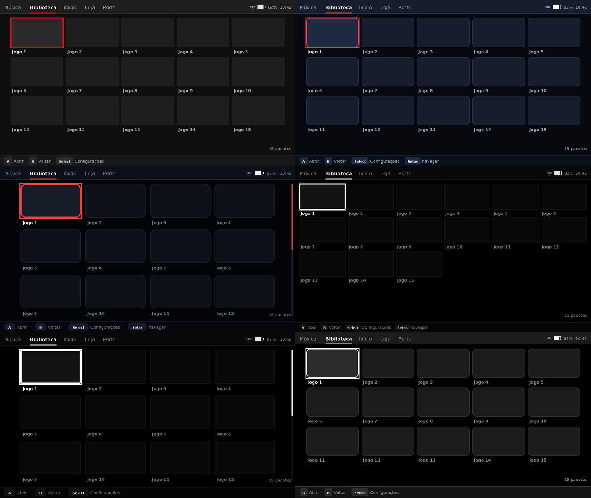
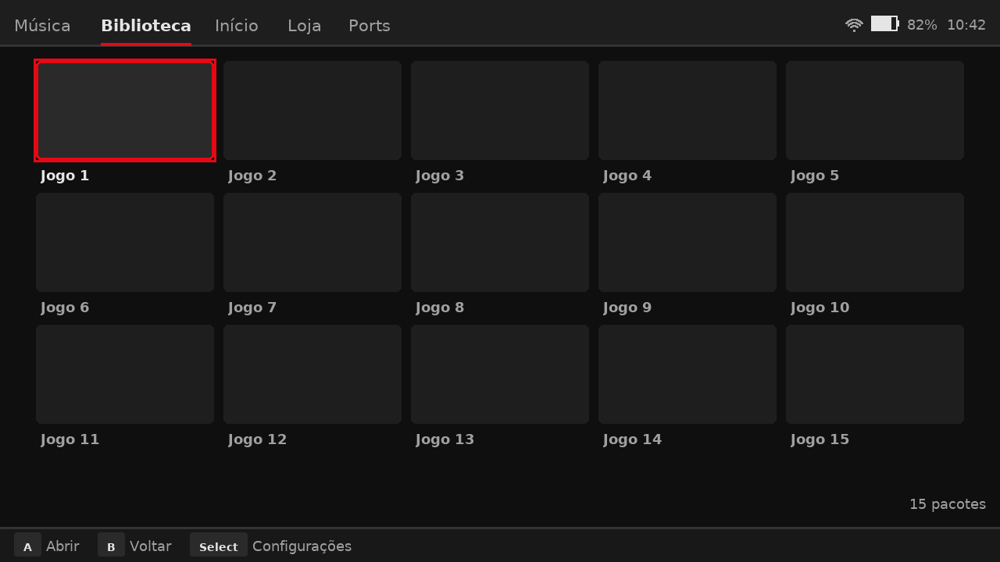
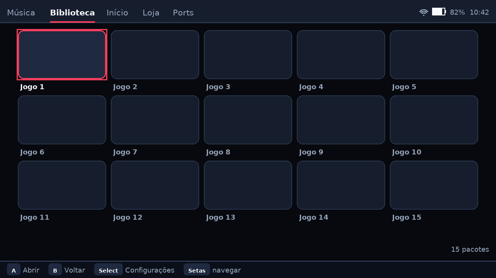
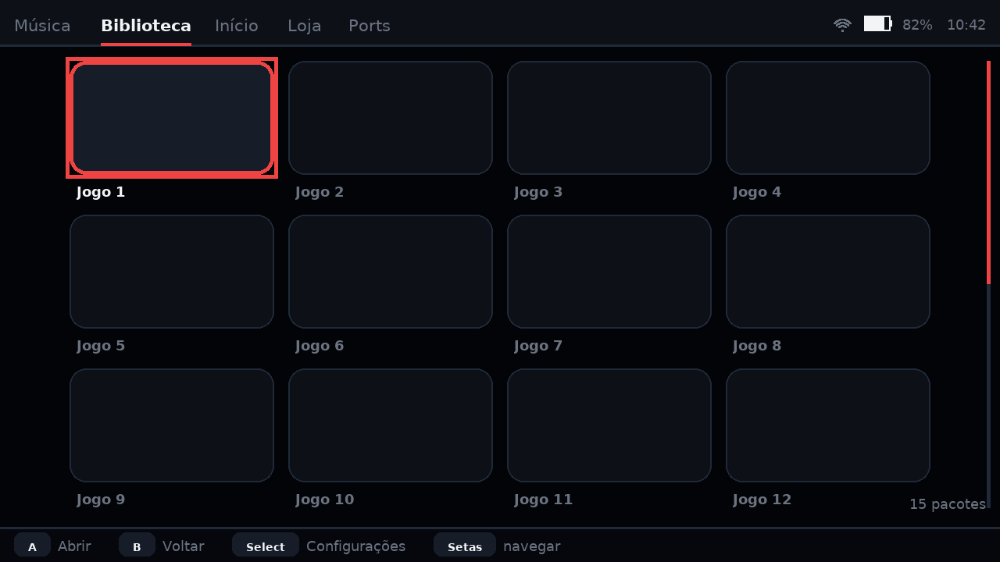
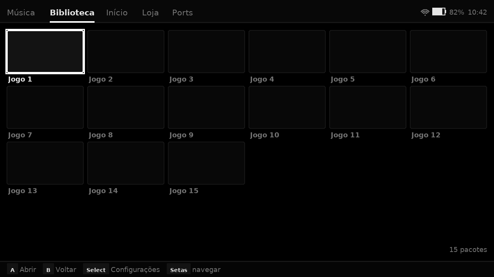
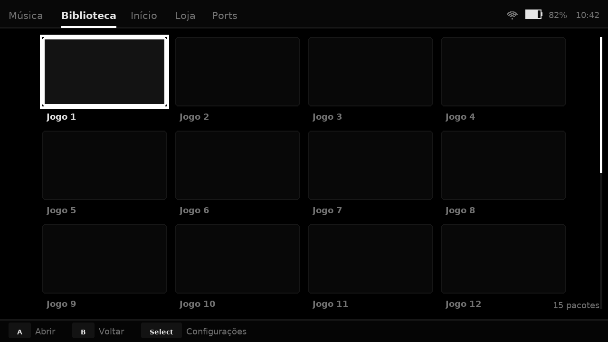
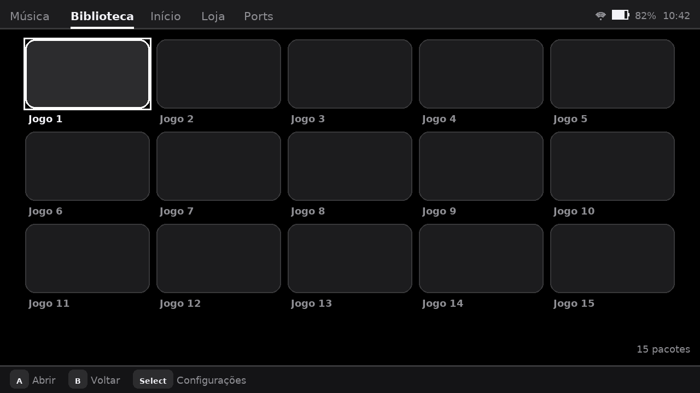

# Temas e opções de layout

Seis temas prontos, todos **dados** em [`assets/themes/`](../assets/themes).
Escolher um não é só trocar cor: o tema diz raio de canto, espessura de borda,
densidade da grade, escala da capa do álbum e o que a barra de dicas mostra.



*Imagens geradas por `make tema-galeria` — rasterização da geometria que o
aparelho usa, não captura de tela.*

---

## 1. As seis opções

| Tema | Origem | Densidade | Grade em 1280×720 | Grade em 640×480 | O que muda |
|---|---|---|---|---|---|
| **Netflix Dark** `dark_default` | projeto original (§4.1.8) | normal | 5×3 (15) | 4×3 (12) | É o tema contra o qual as imagens de referência foram medidas |
| **Neon Rosé** `neon_rose` | mockup 1 | normal | 5×3 (15) | 4×3 (12) | Acento rosé, borda em todo tile, canto 10 px, capa 115 % |
| **Ember Dark** `ember_dark` | mockup 2 | espaçosa | 4×3 (12) | 3×3 (9) | Preto OLED, vermelho vivo, canto 14 px, capa 120 % |
| **Mono Minimal** `mono_minimal` | mockup 3 | compacta | 6×4 (24) | 4×4 (16) | Só preto e branco, canto 3 px, fonte 5 % menor |
| **Mono Gamepad** `mono_gamepad` | mockup 4 | espaçosa | 4×3 (12) | 3×3 (9) | Igual ao Mono, mas a barra de baixo só mostra botão do controle |
| **Glass (iOS)** `ios_glass` | mockup 5 | normal | 5×3 (15) | 4×3 (12) | Cards cinza translúcido, canto 12 px, topbar 36 e hint bar 34 |

**A densidade muda a grade de verdade** — foi medido, não estimado
(`tests/test_themes.py::test_densidade_muda_a_grade_de_verdade`). Se ela só
mexesse no espaço entre tiles, as três opções dariam a mesma contagem de colunas
nos dois painéis e seriam decorativas: com o tile fixo, 640 dá 4 colunas e 1280
dá 5 nos três modos. Por isso o tile também escala (88 % / 100 % / 115 %).

## 2. Cada tema, uma por uma

### Netflix Dark — `dark_default`



O tema original do projeto. Cinza neutro (`#0F0F0F` fundo, `#1E1E1E` card),
acento vermelho `#E50914`, sem borda nos tiles — só o foco tem contorno. É o
tema que reproduz as imagens de `docs/proposta/` e `docs/screenshots/`; mexer
nele invalida a comparação com a referência aprovada.

### Neon Rosé — `neon_rose` (mockup 1)



Azul-noite profundo (`#07090E`), cards `#161E2E` e acento rosé `#F43F5E`.
Canto de 10 px, borda de 1 px em **todo** tile (o look "caixa" do mockup) e a
capa do álbum 15 % maior na aba Música. É o tema padrão de fábrica da X55.

### Ember Dark — `ember_dark` (mockup 2)



Preto quase absoluto (`#020408`), cards `#0D1117`, vermelho `#EF4444`. Canto de
14 px e grade **espaçosa**: 4 colunas em 1280, 3 em 640. Para quem quer menos
coisa na tela.

### Mono Minimal — `mono_minimal` (mockup 3)



Preto absoluto e acento branco: nenhuma cor. Grade **compacta**, 6 colunas em
1280 e 4 em 640 — o máximo de conteúdo por tela. Fonte 5 % menor. É o tema
padrão do `rk3326-generic`, o SoC mais fraco da lista.

### Mono Gamepad — `mono_gamepad` (mockup 4)



Mesma paleta do Mono Minimal, pensado para controle: grade espaçosa, anel de
foco mais grosso e a barra de dicas **sem** o chip "Setas" — num portátil não há
tecla para apertar. É a diferença de `features.hints`.

### Glass (iOS) — `ios_glass` (mockup 5)



Inspirado no iOS: preto puro, cards `#1C1C1E`, divisória `#38383A` (a linha
fina de 0,5 px do mockup vira 1 px, porque 0,5 px não existe no framebuffer),
canto de 12 px. Topbar mais baixa (36) e barra de dicas mais alta (34).

## 3. Como trocar

Três caminhos, do mais permanente ao mais volátil:

| Onde | Vale para | Como |
|---|---|---|
| `settings.json` → `theme_id` | o usuário, agora | menu **Select → Sistema → Tema** (alterna a quente, sem reiniciar) |
| `device/<id>/theme.json` | o aparelho, de fábrica | edite `theme_id` e regere a imagem |
| `--theme ID` / `GIOCHI_THEME` | uma execução | `giochi-launcher --theme mono_minimal` |

Precedência: `--theme` → `GIOCHI_THEME` → `settings.json` → `device-theme.json`
→ padrão do catálogo. Um `theme_id` que não existe mais no catálogo **aparece no
log** e o `settings.json` é corrigido — a UI não muda de cor em silêncio.

## 4. O que um tema pode mudar

Definido em [`schemas/theme.schema.json`](../schemas/theme.schema.json):

```jsonc
{
  "theme_id": "neon_rose",
  "name": "Neon Rosé",
  "colors": { "background": "#07090E", "surface": "#161E2E", /* ... 8 cores */ },
  "metrics": {
    "tile_corner_radius": 10,   // px no PAINEL BASE (640x480); escala como o resto
    "tile_border": 1,           // borda em todo tile (0 = só o foco tem)
    "focus_ring": 2,            // anel de foco, por fora do tile
    "density": "normal",        // compacta | normal | espacosa
    "topbar_height": 40,        // altura da barra superior
    "hint_bar_height": 30,      // altura da barra de dicas
    "cover_pct": 115,           // escala da capa do álbum (100 = 120x120)
    "title_scale_pct": 100      // escala das fontes do painel base
  },
  "features": { "hints": "completo" }   // so_gamepad | completo
}
```

Todas as métricas estão em **px do painel base**: a X55 (720p) recebe tudo
×1,5, como qualquer outro token. Escrever `10` vale 10 em 640×480 e 15 em
1280×720.

## 5. Como criar um tema novo

```sh
cp assets/themes/neon_rose.json assets/themes/meu_tema.json
$EDITOR assets/themes/meu_tema.json          # theme_id, name, colors, metrics

$EDITOR assets/themes/index.json             # acrescente a entrada (a ORDEM é a do menu)

make tema-galeria                            # docs/temas/meu_tema-*.png
make test                                    # a suíte 'temas' cobra o resto
```

O que o `make test` cobra, e por quê:

- **schema** — token fora da faixa (canto > 24, densidade inexistente) falha;
- **contraste medido** (WCAG): texto primário ≥ 4,5:1 sobre fundo, card e card
  elevado; secundário ≥ 3:1; acento ≥ 1,35:1. A cor "bonita" no JSON é a cor
  ilegível no painel de 5 polegadas;
- **paridade do índice** — tema no disco fora do `index.json` (ou o contrário)
  falha, porque o menu Sistema iteraria uma lista e a galeria outra;
- **efeito real** — o teste roda o `dump-geometry` de verdade e exige que a
  densidade mude a grade, que a borda apareça no tile comum e que o modo de
  dicas mude a hint bar. Token que o desenho ignora seria um tema que "não faz
  nada".

## 6. Custo medido

| Item | Valor |
|---|---|
| `font.a8` (dois pesos) | 458 042 B — 68 KiB no SquashFS |
| Textura ARGB8888 do atlas | 1,75 MiB (teto da §4.1.6: 4 MB) |
| Um tema em `assets/themes/` | ~1 KB; seis temas ≈ 6 KB |
| RAM/VRAM de um tema | **0** — o tema é lido no boot e vira número; não há textura de tema |

Trocar de tema a quente relê um JSON de 1 KB e recalcula a geometria; não há
recarga de atlas nem de layout.
